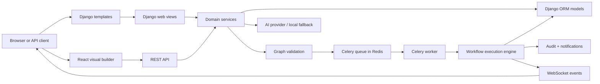
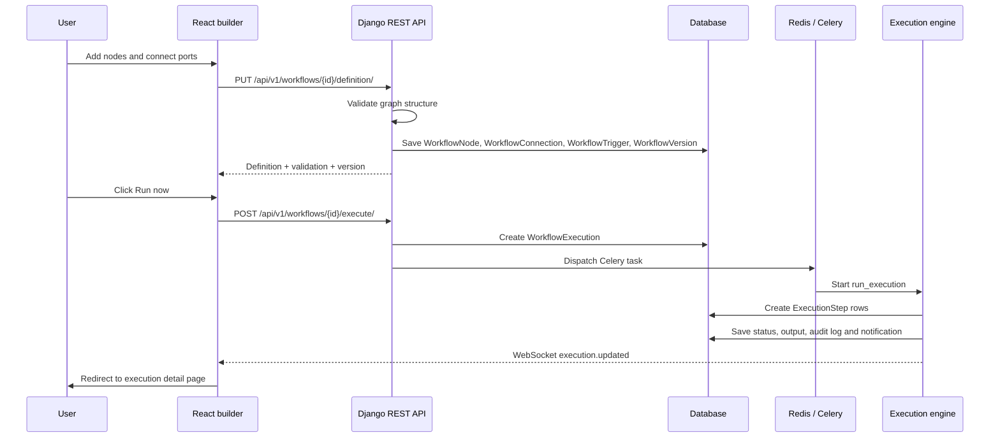
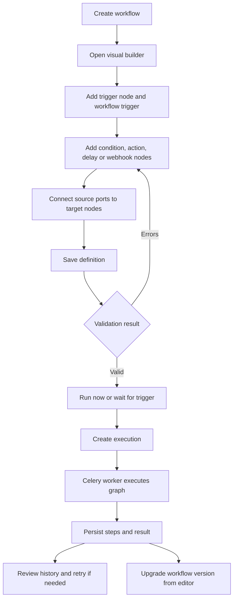
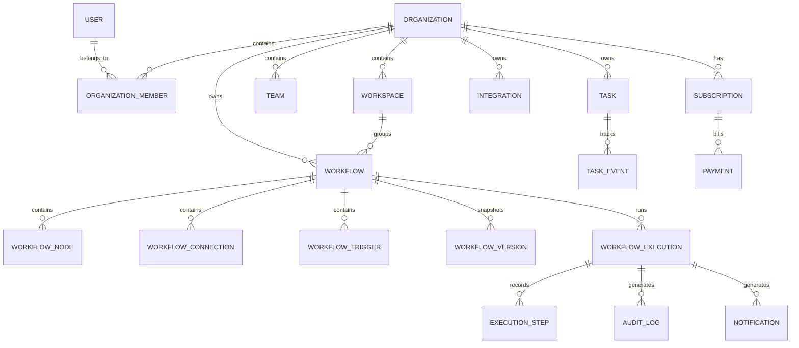

# NexaFlow Application

**AI-powered business workflow automation and management platform.**

**Author / Copyright holder:** N J Bala Manikantan  
**Parent repository:** [`Njbalamani/NEXA-FLOW`](https://github.com/Njbalamani/NEXA-FLOW)  
**Parent overview:** [`../README.md`](../README.md)

This folder contains the complete deployable NexaFlow Django application: models, automation engine, REST API, AI assistant, server-rendered UI, React visual builder, container configuration, CI, docs and tests.

---

## Table of contents

- [Professional project structure](#professional-project-structure)
- [Feature matrix](#feature-matrix)
- [System architecture](#system-architecture)
- [Data flow diagram](#data-flow-diagram)
- [Workflow lifecycle diagram](#workflow-lifecycle-diagram)
- [Database relationships](#database-relationships)
- [Workflow tables](#workflow-tables)
- [API reference summary](#api-reference-summary)
- [Configuration reference](#configuration-reference)
- [Installation commands](#installation-commands)
- [Deployment commands](#deployment-commands)
- [Testing and verification](#testing-and-verification)
- [Security architecture](#security-architecture)
- [Documentation index](#documentation-index)
- [License](#license)

---

## Professional project structure

```text
Nexa-Flow/
├── README.md                       # This detailed application guide
├── manage.py                       # Django CLI entry point
├── requirements.txt                # Python package dependencies
├── Dockerfile                      # Production container definition
├── docker-compose.yml              # Full local/production-like stack
├── entrypoint.sh                   # Container startup script
├── .env.example                    # Environment template, safe to commit
├── .dockerignore                   # Docker build exclusions
├── .gitignore                      # Git exclusions
├── .github/
│   └── workflows/
│       └── ci.yml                  # Django checks and test automation
├── docs/
│   ├── API.md                      # REST, webhook and WebSocket API contract
│   ├── ARCHITECTURE.md             # Architecture and deployment notes
│   ├── ER_DIAGRAM.md               # Database model reference
│   └── INSTALLATION.md             # Setup, deployment and troubleshooting
├── nexaflow/
│   ├── settings.py                 # Settings, DRF, Celery, cache, security
│   ├── urls.py                     # Root URL map
│   ├── celery.py                   # Celery application
│   ├── asgi.py                     # ASGI + WebSocket routing
│   └── wsgi.py                     # Gunicorn entry point
├── apps/
│   ├── accounts/                   # Custom user and authentication flows
│   ├── organizations/              # Organizations, memberships, teams, workspaces
│   ├── workflows/                  # Models, validation, engine, execution, scheduler
│   ├── tasks/                      # Task board, status transitions and events
│   ├── integrations/               # Encrypted credentials and provider metadata
│   ├── notifications/              # In-app notification records
│   ├── billing/                    # Plans, subscriptions, payments and limit checks
│   ├── audit/                      # AuditLog model and cleanup command
│   ├── ai/                         # Workflow generation and AI suggestions
│   ├── analytics/                  # Real-time dashboard metrics
│   ├── api/                        # DRF viewsets, serializers, throttles, schema
│   ├── web/                        # Server-rendered pages and smoke tests
│   ├── health/                     # Health endpoint
│   └── core/                       # Middleware, decorators, permissions, security
├── templates/
│   ├── base.html                   # Application shell and public shell
│   ├── dashboard/                  # Dashboard pages
│   ├── workflows/                  # Workflow list, builder and executions
│   ├── tasks/                      # Task pages
│   ├── integrations/               # Integration pages
│   ├── notifications/              # Notification pages
│   ├── billing/                    # Billing pages
│   ├── organization/               # Organization and profile pages
│   └── ai/                         # AI assistant page
├── static/
│   ├── css/app.css                 # Professional design system
│   ├── js/app.js                   # Shared UI helpers
│   └── js/builder.js               # React workflow editor
└── media/
    └── .gitkeep                    # Uploaded media placeholder
```

---

## Feature matrix

| Domain | Included functionality |
| --- | --- |
| Accounts | Registration, login, logout, profile, token generation, active organization |
| Organizations | Member roles, invitations, workspaces, teams and organization-scoped queries |
| Workflows | Graph CRUD, templates, versions, validation, manual/scheduled/webhook execution |
| Builder | Drag/drop palette, click-to-add nodes, port linking, connection removal, JSON inspector |
| Engine | Safe AST evaluation, condition branches, retries, execution steps and cancellation |
| Tasks | Create, assign, update, filter, search and event history |
| Integrations | Slack, webhook, HTTP, email and provider credentials with encryption |
| Notifications | Creation, read/unread state, mark all read and execution failure alerts |
| Billing | Free/pro/enterprise plans, usage counters, safe test payment flow |
| Audit | Action logs with actor, organization, target, IP and metadata |
| AI | Generate workflow JSON, recommend templates, suggest fixes, explain failures |
| Analytics | Workflow counts, execution success rate, task health and chart-ready metrics |

---

## System architecture



### Layer responsibilities

| Layer | Responsibility |
| --- | --- |
| Presentation | Server-rendered pages, builder canvas, charts and accessibility |
| Web | Request routing, authentication decorators, forms and page context |
| API | Serializers, viewsets, throttles, permissions and OpenAPI schema |
| Services | Reusable domain operations such as save definition and template application |
| Validation | Node, connection, trigger, reachability and cycle checks |
| Engine | Step execution, branching, retries, context rendering and result capture |
| Data | PostgreSQL/SQLite models with organization ownership on every tenant record |
| Async | Celery worker for execution and beat for scheduled triggers |
| Observability | Health endpoint, audit log, notifications and execution history |

---

## Data flow diagram



---

## Workflow lifecycle diagram



### Execution statuses

| Status | Description | User action |
| --- | --- | --- |
| `queued` | Created and waiting for worker | Wait or confirm worker is online |
| `running` | Graph is executing | Open live execution view |
| `success` | All reachable nodes finished | Review outputs |
| `failed` | A node or validation failed | Inspect step error and retry |
| `cancelled` | Stopped by user | Retry from last successful step |

---

## Database relationships



---

## Workflow tables

### Builder components

| Component | Port behavior | Required configuration |
| --- | --- | --- |
| Trigger | Single output `out` | Paired with a trigger definition |
| Condition | Outputs `true` and `false` | `field`, `operator`, `value` |
| Action | Single output `out` | `action` and action-specific fields |
| Delay | Single output `out` | `seconds` |
| Transform | Single output `out` | `variables` object |
| Webhook | Single output `out` | `url`, `method`, optional `headers` and `body` |

### Trigger definitions

| Type | Schedule / invocation | Typical config |
| --- | --- | --- |
| Manual | Button or API call | Empty object |
| Schedule | Celery beat every minute | `mode: interval` and `minutes`, or cron fields |
| Webhook | Signed HTTP POST | Generated token and signing secret |
| API | REST execute action | Optional input JSON |
| Event | Internal event hook | Event name and payload map |

### Version and execution records

| Model | Key fields | Purpose |
| --- | --- | --- |
| `WorkflowVersion` | `workflow`, `version`, `definition`, `created_by` | Snapshot each save and allow restore |
| `WorkflowExecution` | `status`, `input`, `trigger_type`, `error`, `result` | One workflow run |
| `ExecutionStep` | `node_key`, `status`, `input`, `output`, `error` | Per-node run result |
| `WebhookDelivery` | `signature`, `payload`, `response_status`, `delivered_at` | Webhook audit and retry |
| `AuditLog` | `actor`, `action`, `target`, `organization`, `metadata` | Security and activity trail |

---

## API reference summary

| Method | Endpoint | Purpose |
| --- | --- | --- |
| `POST` | `/api/v1/auth/register/` | Create account and organization |
| `POST` | `/api/v1/auth/login/` | Get auth token |
| `GET/POST` | `/api/v1/workflows/` | List or create workflows |
| `GET/PUT` | `/api/v1/workflows/{id}/definition/` | Read or save graph |
| `POST` | `/api/v1/workflows/{id}/validate-draft/` | Validate unsaved definition |
| `POST` | `/api/v1/workflows/{id}/execute/` | Queue execution; returns `execution_url` |
| `POST` | `/api/v1/workflows/{id}/duplicate/` | Clone workflow |
| `POST` | `/api/v1/workflows/{id}/restore-version/` | Restore a saved version |
| `GET` | `/api/v1/workflows/templates/` | List workflow templates |
| `POST` | `/api/v1/workflows/{id}/use-template/` | Apply a template |
| `GET/POST` | `/api/v1/tasks/` | Task CRUD and bulk updates |
| `GET/POST` | `/api/v1/integrations/` | Integration registry and credentials |
| `GET` | `/api/v1/webhook-deliveries/` | Webhook delivery history |
| `POST` | `/api/v1/webhook-deliveries/{id}/retry/` | Retry a webhook delivery |
| `GET` | `/api/v1/analytics/dashboard/` | Dashboard metrics |
| `GET` | `/health/` | Health status |
| `GET` | `/api/schema/`, `/api/docs/`, `/api/redoc/` | OpenAPI documentation |

Full details are in [`docs/API.md`](docs/API.md).

---

## Configuration reference

| Variable | Required in production | Description |
| --- | --- | --- |
| `DEBUG` | Yes | Must be `false` |
| `DJANGO_SECRET_KEY` | Yes | Long random signing secret |
| `DATABASE_URL` | Yes | PostgreSQL connection string |
| `CELERY_BROKER_URL` | Yes | Redis broker URL |
| `CELERY_RESULT_BACKEND` | Yes | Redis result backend URL |
| `CACHE_URL` | Recommended | Shared cache for replay protection |
| `CELERY_TASK_ALWAYS_EAGER` | No | Local in-process execution flag |
| `NEXAFLOW_ENCRYPTION_KEY` | Yes | Fernet key source for credentials |
| `AI_API_KEY` | No | Provider-backed AI; local fallback otherwise |
| `EMAIL_*` | Recommended | SMTP settings |
| `ALLOWED_HOSTS` | Yes | Host allowlist |
| `CSRF_TRUSTED_ORIGINS` | Yes | Trusted origin allowlist |
| `WEBHOOK_MAX_BODY_BYTES` | No | Webhook payload size guard |
| `WEBHOOK_REPLAY_TTL_SECONDS` | Recommended | Duplicate delivery window |
| `WEBHOOK_RATE_LIMIT_PER_MINUTE` | Recommended | Per-IP webhook throttle |
| `TRUST_X_FORWARDED_FOR` | Conditional | Enable only behind trusted proxy |
| `ALLOWED_ENV_HEADERS` | No | Allowlist for workflow header env references |

---

## Installation commands

### Clone and run from repository root

```powershell
git clone https://github.com/Njbalamani/NEXA-FLOW.git
cd NEXA-FLOW\Nexa-Flow
py -3.12 -m venv .venv
.\.venv\Scripts\Activate.ps1
pip install -r requirements.txt
Copy-Item .env.example .env
python manage.py migrate
python manage.py createsuperuser
python manage.py runserver
```

```bash
git clone https://github.com/Njbalamani/NEXA-FLOW.git
cd NEXA-FLOW/Nexa-Flow
python3.12 -m venv .venv
source .venv/bin/activate
pip install -r requirements.txt
cp .env.example .env
python manage.py migrate
python manage.py createsuperuser
python manage.py runserver
```

### Local in-process mode

Set this in `.env` when Redis is unavailable:

```env
CELERY_TASK_ALWAYS_EAGER=true
```

### Background workers

```powershell
celery -A nexaflow worker -l info
celery -A nexaflow beat -l info
python manage.py run_scheduler
python manage.py cleanup_audit_logs --days 90 --dry-run
```

---

## Deployment commands

### Docker Compose stack

```powershell
Copy-Item .env.example .env
docker compose up --build
docker compose exec web python manage.py createsuperuser
docker compose ps
docker compose logs -f web celery_worker celery_beat
```

```bash
cp .env.example .env
docker compose up --build
docker compose exec web python manage.py createsuperuser
docker compose ps
docker compose logs -f web celery_worker celery_beat
```

### Container details

| Service | Image / build | Port | Purpose |
| --- | --- | --- | --- |
| `web` | Local `Dockerfile` | `8000` | Gunicorn-served Django app |
| `db` | `postgres:16-alpine` | internal `5432` | Persistent application data |
| `redis` | `redis:7-alpine` | internal `6379` | Broker, results and cache |
| `celery_worker` | Local `Dockerfile` | none | Executes workflow tasks |
| `celery_beat` | Local `Dockerfile` | none | Schedules periodic workflow runs |

### Production server

```bash
python manage.py migrate --noinput
python manage.py collectstatic --noinput
gunicorn nexaflow.wsgi:application --bind 0.0.0.0:8000 --workers 4 --timeout 120
```

See [`docs/INSTALLATION.md`](docs/INSTALLATION.md) for the full checklist and troubleshooting guide.

---

## Testing and verification

```powershell
python manage.py test -v 1
python manage.py makemigrations --check --dry-run
python manage.py check
python manage.py collectstatic --noinput
python manage.py spectacular --validate --fail-on-warn
```

```bash
python manage.py test -v 1
python manage.py makemigrations --check --dry-run
python manage.py check
python manage.py collectstatic --noinput
python manage.py spectacular --validate --fail-on-warn
```

The automated suite verifies authentication, graph validation, execution, branching, scheduled triggers, webhooks, replay protection, permissions, cross-organization guards, tasks, billing, AI, analytics and rendering.

---

## Security architecture

- Organization ownership is stored on tenant records and checked in views/API actions.
- Role checks protect manager-only workflow edits and billing operations.
- Integration credentials are encrypted and hidden from browser responses.
- Webhook endpoints require URL token, timestamp and HMAC-SHA256 signature.
- Replay protection uses Redis cache with signature deduplication.
- SSRF guard blocks private, loopback, link-local and metadata destinations.
- Workflow expressions are parsed with a restricted AST evaluator.
- Security headers are added to every response.
- `.env`, databases, static build output and caches are excluded from git.

---

## Documentation index

| Document | Description |
| --- | --- |
| [`README.md`](README.md) | This application guide |
| [`docs/API.md`](docs/API.md) | REST, webhook, WebSocket and OpenAPI reference |
| [`docs/ARCHITECTURE.md`](docs/ARCHITECTURE.md) | Component and deployment architecture |
| [`docs/ER_DIAGRAM.md`](docs/ER_DIAGRAM.md) | Database model and relationship details |
| [`docs/INSTALLATION.md`](docs/INSTALLATION.md) | Installation, production deployment and troubleshooting |

---

## License

MIT License. Copyright (c) 2026 **N J Bala Manikantan**. See [`LICENSE`](LICENSE).
