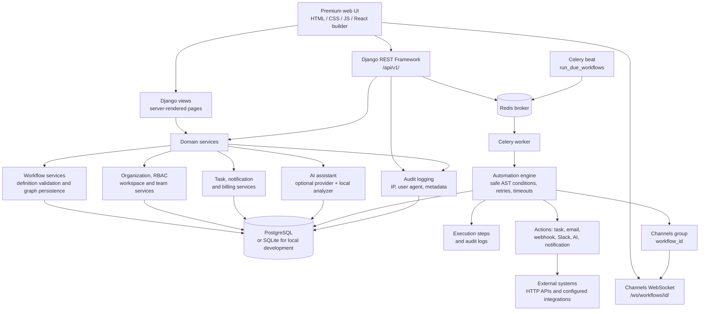

# NexaFlow architecture

## Request and execution flow

1. A user authenticates through Django session login or DRF token authentication.
2. Organization context is resolved from `X-Organization-ID`, a query parameter, or the user's active organization. RBAC is checked on every API view.
3. The React builder edits a workflow definition JSON document and saves it through `PUT /api/v1/workflows/{id}/definition/`.
4. `save_workflow_definition` validates the graph, rejects cycles and unknown node types, then persists nodes, connections and triggers atomically.
5. Manual, scheduled and webhook triggers create a `WorkflowExecution` and enqueue a Celery task.
6. The worker loads the persisted graph and walks it from trigger nodes. Conditions are evaluated with a restricted AST evaluator; no `eval` or `exec` is used.
7. Every step writes an `ExecutionStep` row. Failures trigger bounded retries, audit entries, notifications and a WebSocket event.
8. Analytics endpoints aggregate the same database records used by the engine, so dashboard numbers are never synthetic.

## Security boundaries

- Secrets stay in environment variables or encrypted server-side fields and are never serialized to the browser.
- Webhook endpoints require a URL token plus an HMAC-SHA256 signature, with optional timestamp/nonce signing and cache-backed replay deduplication.
- Outbound HTTP actions reject private/metadata hosts unless explicitly running in local debug mode.
- DRF scoped throttles limit authentication, general API, AI, billing and webhook traffic.
- Role checks enforce viewer/member/manager/admin/owner capabilities.
- Workflow graphs are validated before save and again before execution. Cycles, unbounded retries, oversized expressions and unsafe outbound URLs are rejected.
- Workflow actions may read environment variables only when the variable name is present in `ALLOWED_ENV_HEADERS`.
- Execution steps are upserted per node, so Celery retries resume from successful steps instead of duplicating side effects.
- Audit logs record actor, action, target, IP, user agent and metadata.

## Module map

| Module | Django app | Responsibility |
| --- | --- | --- |
| Authentication and organizations | `accounts`, `organizations` | Users, memberships, roles, workspaces, teams |
| Visual builder | `workflows`, `api` | React canvas, graph persistence, validation |
| Automation engine | `workflows` | Execution, retries, scheduling, webhooks |
| Task management | `tasks`, `notifications` | Assignment, deadlines, history, alerts |
| Integrations | `integrations` | Encrypted credentials and delivery logs |
| AI assistant | `ai` | Generation, recommendations, failure explanations |
| Analytics | `analytics` | Real database aggregates and charts |
| Subscriptions | `billing` | Plans, limits, test payment gateway |
| Audit | `audit` | Security and operational event trail |
