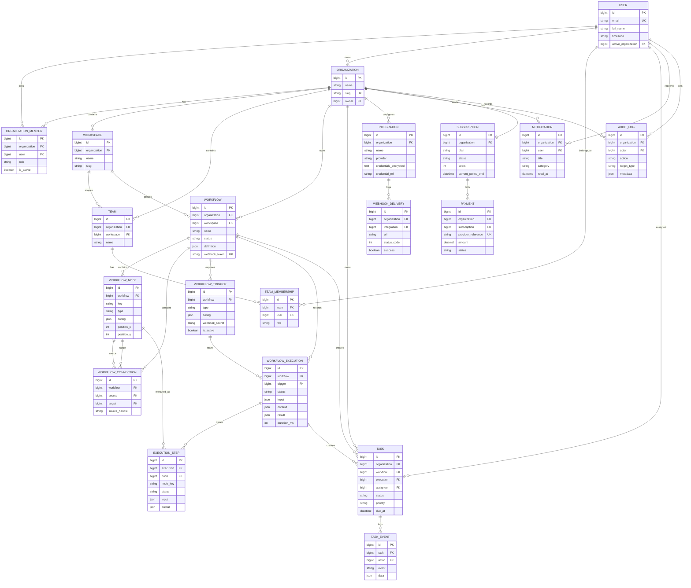

# NexaFlow database ER diagram

All timestamps use UTC. Unique constraints include `(organization, slug)` for workflows and workspaces, `(workflow, key)` for nodes, `(workflow, source, target, source_handle)` for connections, and `(organization, user)` for memberships.
