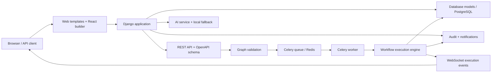
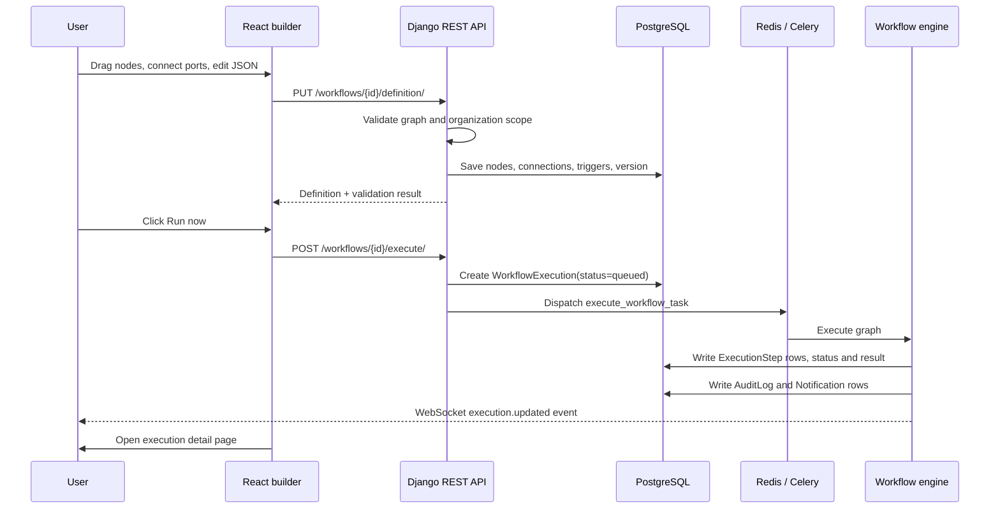
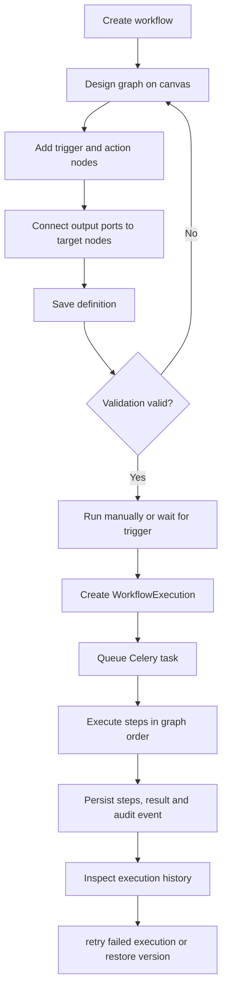
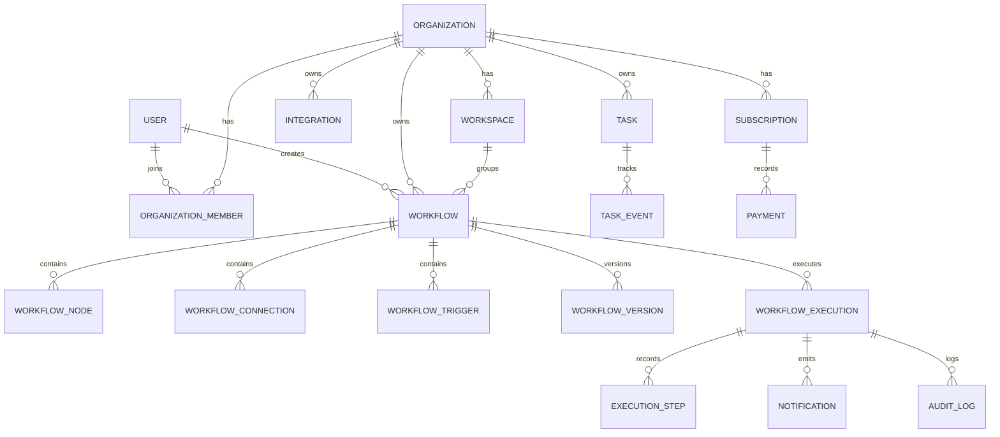

# NexaFlow

**AI-powered business workflow automation and management platform.**

**Author / Copyright holder:** N J Bala Manikantan  
**Repository:** `Njbalamani/NEXA-FLOW`  
**Deployable application:** [`Nexa-Flow/`](Nexa-Flow/README.md)

NexaFlow helps teams design visual workflows, connect business systems, automate tasks, and inspect every execution with database-backed analytics. This repository is organized as a single production source tree inside the `Nexa-Flow/` folder so the Django application can be cloned, installed, tested, containerized, and deployed independently.

---

## Table of contents

- [Professional repository structure](#professional-repository-structure)
- [Capabilities](#capabilities)
- [Application architecture](#application-architecture)
- [Data flow diagram](#data-flow-diagram)
- [Workflow lifecycle](#workflow-lifecycle)
- [Database relationship diagram](#database-relationship-diagram)
- [Workflow building blocks](#workflow-building-blocks)
- [Core REST API surface](#core-rest-api-surface)
- [Environment variables](#environment-variables)
- [Install commands](#install-commands)
- [Docker deployment](#docker-deployment)
- [Production deployment checklist](#production-deployment-checklist)
- [Verification commands](#verification-commands)
- [Security model](#security-model)
- [License](#license)

---

## Professional repository structure

```text
NEXA-FLOW/
├── README.md                       # Repository overview and deployment guide
├── LICENSE                         # MIT License - N J Bala Manikantan
├── .gitignore                      # Secrets, databases, caches and build output exclusions
└── Nexa-Flow/                      # Deployable Django project
    ├── README.md                   # Detailed application README
    ├── manage.py                   # Django command-line entry point
    ├── requirements.txt            # Pinned Python dependencies
    ├── Dockerfile                  # Production container image
    ├── docker-compose.yml          # Web, PostgreSQL, Redis, Celery worker and beat
    ├── entrypoint.sh               # Container startup: migrate, collectstatic, gunicorn
    ├── .env.example                # Safe environment variable template
    ├── .dockerignore               # Container build exclusions
    ├── .github/
    │   └── workflows/
    │       └── ci.yml              # Automated checks and tests
    ├── docs/
    │   ├── API.md                  # REST API, webhook and WebSocket contract
    │   ├── ARCHITECTURE.md         # Component and deployment architecture
    │   ├── ER_DIAGRAM.md           # Data model reference
    │   └── INSTALLATION.md         # Detailed setup and production guide
    ├── nexaflow/                   # Project settings, URLs, Celery and ASGI routing
    │   ├── settings.py
    │   ├── urls.py
    │   ├── celery.py
    │   ├── asgi.py
    │   └── wsgi.py
    ├── apps/
    │   ├── accounts/               # Custom user model and authentication
    │   ├── organizations/          # Organizations, memberships, workspaces and teams
    │   ├── workflows/              # Graph model, validation, engine, Celery tasks, scheduler
    │   ├── tasks/                  # Work items, events and status workflow
    │   ├── integrations/           # Encrypted credentials and provider registry
    │   ├── notifications/          # User notifications and delivery events
    │   ├── billing/                # Plans, subscriptions, payments and usage limits
    │   ├── audit/                  # Audit log and retention cleanup command
    │   ├── ai/                     # AI generation, recommendations and local fallback
    │   ├── analytics/              # Dashboard metrics from real database records
    │   ├── api/                    # DRF viewsets, serializers, throttles and OpenAPI schema
    │   ├── web/                    # Server-rendered application pages
    │   ├── health/                 # Liveness/readiness endpoint
    │   └── core/                   # Shared middleware, decorators, permissions and security
    ├── templates/                  # Django templates for product, auth and builder pages
    ├── static/
    │   ├── css/app.css             # Design system and responsive UI
    │   ├── js/app.js               # Navigation, charts and motion helpers
    │   └── js/builder.js           # React visual workflow editor
    └── media/
        └── .gitkeep                # Uploaded media placeholder
```

---

## Capabilities

| Area | What is included |
| --- | --- |
| Identity | Custom user, registration, token/session auth, active organization context |
| Multi-tenancy | Organizations, roles, memberships, workspaces, teams and strict org scoping |
| Visual builder | React drag/drop canvas, node ports, branch routing, JSON inspector, save and validate |
| Automation engine | Deterministic graph runner, safe expression evaluator, retries and execution history |
| Triggers | Manual, schedule, webhook, API and event triggers |
| Actions | Create task, send email, HTTP request, webhook, Slack, notification, log and AI steps |
| Tasks | Assignment, priority, due dates, status transitions and event history |
| Integrations | Encrypted credentials, email, webhook, Slack, REST API and AI provider support |
| AI assistant | Natural language workflow generation, recommendations, improvements and failure explanations |
| Analytics | Real metrics for workflows, executions, tasks, success rate and trends |
| Billing | Free/pro/enterprise plans, enforcement limits and safe test payments |
| Audit | Immutable-style action trail and retention cleanup command |
| Security | RBAC, HMAC webhooks, replay protection, SSRF guards, audit logging and security headers |

---

## Application architecture



### Technology stack

| Layer | Technology |
| --- | --- |
| Backend | Python 3.12, Django 6.1, Django REST Framework, Celery |
| Database | PostgreSQL 16 in production/containers, SQLite for local quick start |
| Cache / broker | Redis 7 for Celery, results and shared replay protection |
| Frontend | Django templates, React 18 UMD, Babel standalone, Chart.js, GSAP, Three.js |
| API docs | drf-spectacular, Swagger UI and ReDoc |
| Server | Gunicorn behind a reverse proxy |
| Containers | Docker and Docker Compose |
| CI | GitHub Actions with Django checks and full test suite |

---

## Data flow diagram



---

## Workflow lifecycle



### Execution states

| State | Meaning |
| --- | --- |
| `queued` | Execution created and waiting for a worker |
| `running` | Engine is processing nodes |
| `success` | All reachable nodes completed |
| `failed` | A node raised an error or validation failed |
| `cancelled` | User cancelled the execution before completion |

---

## Database relationship diagram



---

## Workflow building blocks

### Node types

| Node | Purpose | Typical configuration |
| --- | --- | --- |
| `trigger` | Starting point in the graph | Payload placeholder; paired with a workflow trigger |
| `condition` | Routes to `true` or `false` branch | `field`, `operator`, `value` |
| `action` | Runs a business operation | `action`, `message`, `retry_attempts` |
| `delay` | Waits before continuing | `seconds` |
| `transform` | Sets context variables | `variables` object |
| `webhook` | Calls an external HTTPS endpoint | `url`, `method`, `headers`, `body` |

### Trigger types

| Trigger | Invocation | Notes |
| --- | --- | --- |
| `manual` | Run now button or API execute action | Uses optional input JSON |
| `schedule` | Celery beat every minute | Interval or cron configuration |
| `webhook` | Signed HTTP POST | HMAC-SHA256, timestamp tolerance and replay cache |
| `api` | REST API call | Organization scoped and permission checked |
| `event` | Internal application event | Reserved for event-driven integrations |

### Action types

| Action | Description |
| --- | --- |
| `create_task` | Creates an assigned task with optional due date |
| `send_email` | Sends SMTP email to one or more recipients |
| `http_request` | Calls an allowlisted external endpoint |
| `webhook` | Sends structured webhook payload |
| `slack` | Posts a message through Slack-compatible webhook |
| `notification` | Creates an in-app notification |
| `log` | Records a step result without external side effects |
| `ai` | Uses configured AI provider with deterministic local fallback |

---

## Core REST API surface

| Method | Endpoint | Purpose |
| --- | --- | --- |
| `POST` | `/api/v1/auth/register/` | Register user, organization, workspace and free plan |
| `POST` | `/api/v1/auth/login/` | Obtain token |
| `GET` | `/api/v1/workflows/` | List/search/order/paginate workflows |
| `POST` | `/api/v1/workflows/` | Create a workflow |
| `GET` | `/api/v1/workflows/{id}/definition/` | Read complete graph definition |
| `PUT` | `/api/v1/workflows/{id}/definition/` | Save graph, nodes, connections and triggers |
| `POST` | `/api/v1/workflows/{id}/validate-draft/` | Validate unsaved graph |
| `POST` | `/api/v1/workflows/{id}/execute/` | Queue an execution and return `execution_url` |
| `GET` | `/api/v1/workflows/templates/` | List reusable workflow templates |
| `POST` | `/api/v1/workflows/{id}/use-template/` | Apply a template to a workflow |
| `GET` | `/api/v1/executions/{id}/steps/` | Inspect paginated execution steps |
| `GET` | `/api/v1/webhook-deliveries/` | Inspect webhook deliveries and retries |
| `GET` | `/health/` | Liveness/readiness status |
| `GET` | `/api/schema/`, `/api/docs/`, `/api/redoc/` | OpenAPI schema and interactive docs |

---

## Environment variables

Copy `.env.example` to `.env` before running the app. Never commit `.env`.

| Variable | Purpose |
| --- | --- |
| `DEBUG` | Enables development behavior; set to `false` in production |
| `DJANGO_SECRET_KEY` | Django signing secret |
| `DATABASE_URL` | PostgreSQL or SQLite connection string |
| `CELERY_BROKER_URL` | Redis broker URL |
| `CELERY_RESULT_BACKEND` | Celery result store URL |
| `CELERY_TASK_ALWAYS_EAGER` | Runs tasks in-process for local development |
| `CACHE_URL` | Redis cache used by webhook replay protection |
| `NEXAFLOW_ENCRYPTION_KEY` | Fernet key source for encrypted integration credentials |
| `AI_API_KEY` | Optional provider-backed AI key |
| `EMAIL_HOST`, `EMAIL_PORT`, `EMAIL_HOST_USER`, `EMAIL_HOST_PASSWORD` | SMTP configuration |
| `ALLOWED_HOSTS` | Comma-separated host allowlist |
| `CSRF_TRUSTED_ORIGINS` | Comma-separated trusted origins |
| `WEBHOOK_REPLAY_TTL_SECONDS` | Duplicate webhook delivery cache window |
| `WEBHOOK_RATE_LIMIT_PER_MINUTE` | Per-IP webhook rate limit |
| `TRUST_X_FORWARDED_FOR` | Set `true` only behind a trusted proxy |
| `ALLOWED_ENV_HEADERS` | Allowlist of environment variables workflows may read |

---

## Install commands

### Windows PowerShell

```powershell
git clone https://github.com/Njbalamani/NEXA-FLOW.git
cd NEXA-FLOW\Nexa-Flow
py -3.12 -m venv .venv
.\.venv\Scripts\Activate.ps1
pip install -r requirements.txt
Copy-Item .env.example .env
python manage.py migrate
python manage.py createsuperuser
python manage.py runserver
```

Open `http://127.0.0.1:8000/`.

### Linux / macOS

```bash
git clone https://github.com/Njbalamani/NEXA-FLOW.git
cd NEXA-FLOW/Nexa-Flow
python3.12 -m venv .venv
source .venv/bin/activate
pip install -r requirements.txt
cp .env.example .env
python manage.py migrate
python manage.py createsuperuser
python manage.py runserver
```

### Background workers without Docker

```powershell
celery -A nexaflow worker -l info
celery -A nexaflow beat -l info
python manage.py run_scheduler
```

For local development without Redis, set `CELERY_TASK_ALWAYS_EAGER=true` in `.env`.

---

## Docker deployment

Run from the `Nexa-Flow/` folder:

```powershell
Copy-Item .env.example .env
docker compose up --build
```

```bash
cp .env.example .env
docker compose up --build
```

| Service | Purpose |
| --- | --- |
| `web` | Django + gunicorn on port `8000` |
| `db` | PostgreSQL 16 with persistent volume |
| `redis` | Celery broker, results and cache |
| `celery_worker` | Executes queued workflow runs |
| `celery_beat` | Enqueues scheduled triggers |

Create an administrator:

```powershell
docker compose exec web python manage.py createsuperuser
```

Stop while preserving data:

```powershell
docker compose down
```

---

## Production deployment checklist

1. Set `DEBUG=false` and generate a long random `DJANGO_SECRET_KEY`.
2. Set real `ALLOWED_HOSTS` and `CSRF_TRUSTED_ORIGINS`.
3. Use managed PostgreSQL and Redis; do not reuse development credentials.
4. Set `NEXAFLOW_ENCRYPTION_KEY` before storing integration credentials.
5. Configure SMTP with the `EMAIL_*` variables.
6. Run `python manage.py migrate` and `python manage.py collectstatic --noinput`.
7. Serve `staticfiles/` through nginx or a CDN.
8. Terminate TLS at the load balancer; the app enables HSTS and secure cookies when `DEBUG=false`.
9. Run gunicorn behind a reverse proxy.
10. Run Celery worker and beat as separate always-on processes.
11. Enable `TRUST_X_FORWARDED_FOR` only when a trusted proxy overwrites that header.
12. Apply network-level outbound restrictions in addition to the app's SSRF guard.
13. Back up PostgreSQL and monitor `WorkflowExecution`, `AuditLog` and Celery queue depth.

Example production server command:

```bash
gunicorn nexaflow.wsgi:application --bind 0.0.0.0:8000 --workers 4 --timeout 120
```

---

## Verification commands

Run from the `Nexa-Flow/` folder:

```powershell
python manage.py test -v 1
python manage.py makemigrations --check --dry-run
python manage.py check
python manage.py collectstatic --noinput
python manage.py spectacular --validate --fail-on-warn
python manage.py cleanup_audit_logs --days 90 --dry-run
```

The suite covers authentication, workflow validation, execution, conditional routing, webhooks, replay protection, RBAC, cross-organization guards, tasks, notifications, billing, AI, analytics and page rendering.

---

## Security model

- Secrets are read from environment variables and `.env` is ignored by git.
- Integration credentials are encrypted at rest and never returned to the browser.
- Workflow expressions use a restricted AST evaluator instead of `eval` or `exec`.
- GraphQL-style graph cycles and unknown nodes are rejected before execution.
- Webhooks require token plus HMAC-SHA256 signature and are deduplicated by signature.
- Organization scoping is enforced in web views, DRF viewsets and custom actions.
- Security headers are applied to every response.
- Test payments never contact a real gateway.

---

## License

MIT License. Copyright (c) 2026 **N J Bala Manikantan**. See [LICENSE](LICENSE).
